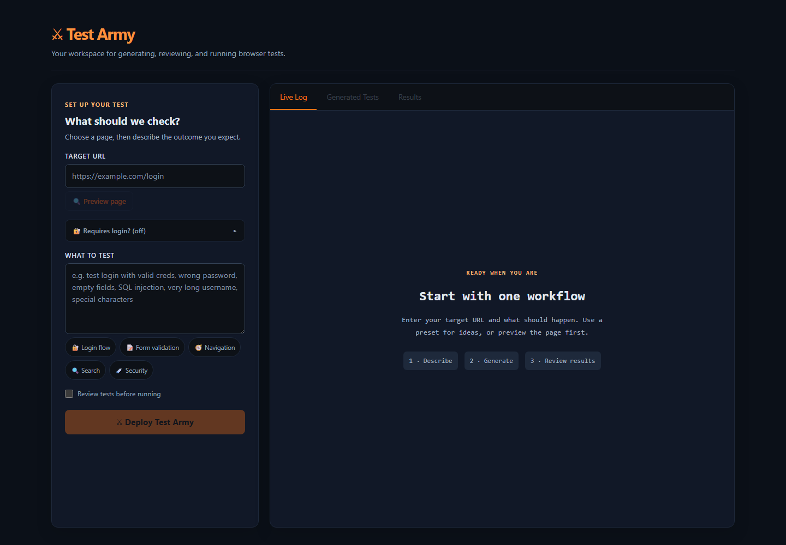

# Test Army QA

Local QA assistant: inspect a target page, describe scenarios, generate editable
Playwright tests, run them, and review results and screenshots.

## Project site

Visit the [Test Army project site](https://parth6001.github.io/test-army-qa/) for
the app screenshot, workflow, technology, data flow, and current limitations.



The static project site deploys from `docs/` with GitHub Actions whenever `main`
changes. Enable GitHub Pages with **GitHub Actions** as the source in repository
settings. Regenerate the clean UI screenshot with `npm run capture:preview`.

Start the UI with `npm run dev` and the backend in a second terminal with
`npm run server`, then open `http://localhost:5173`. The existing
`npm run dev:all` script starts both processes together. Browser binaries and the
chosen provider configuration are required for generation/execution. Keep keys
and browser sessions local; see `.gitignore`.

Project planning and progress:

- [Project review and product direction](docs/PROJECT_REVIEW.md)
- [Task tracker, blockers, and next steps](docs/TASKS.md)
- [QA and E2E review strategy](docs/QA_STRATEGY.md)
- [Project memory](docs/PROJECT_MEMORY.md)

As of 2026-10-10, TA-001 and TA-004a/b are complete. TA-002/003 remain in review
for real runner and process-cleanup evidence; TA-004c is the next security task.
See the tracker and verification notes for current results. The roadmap describes
planned capabilities, not completed features.

## Local setup

Install a Node.js version supported by the package engines, then from the project
directory run:

```powershell
npm ci
npx playwright install chromium
```

For UI generation, configure the chosen provider in your local `.env`:
`LLM_BACKEND=openrouter` with `OPENROUTER_API_KEY`, or `LLM_BACKEND=claude` with
working Claude Agent SDK authentication. The standalone `npm run generate -- <url>`
command uses `ANTHROPIC_API_KEY` separately. Provider access is not needed for
the own-app UI tests below. Do not commit credentials or saved browser sessions.

## Development checks

```powershell
npm run build
npm run lint
npm run test:contracts
npm run test:unit
npm run test:e2e
```

`npm run test:all` runs contract tests, component-unit tests, then the browser suite. To inspect
browser test discovery without running a browser, use `npm run test:e2e -- --list`.

- Unit tests cover required inputs, presets, review mode, and inspection errors.
- Contract tests exercise report identity, result classification and stream/error
  handling in Node without a browser or provider. Browser discovery now lists 17
  scenarios, including incorrect responses and unsuccessful runs.
- Browser UI tests live in `tests/app/` and use controlled API responses. They
  cover preview, review/edit/run, and supplied pass/fail reports. They do not
  establish real backend, live model, or target-product correctness.
- Playwright starts its own Vite instance at `http://127.0.0.1:5174` with a strict
  port and no server reuse. Keep that port free; your normal port 5173 session
  can stay open. Failure traces and screenshots are kept under `test-results/`.
- Generated target specs remain outside `tests/app/`. The UI's external runner
  configuration is unchanged. Run a specific target spec explicitly only when
  its target, credentials, and test actions are appropriate:

```powershell
npx playwright test --config=playwright.external.config.ts tests/generated_YOUR_TARGET.spec.ts
```

If a check reports `spawn EPERM`, record it as blocked and rerun in an environment
that permits Node child processes and Playwright browsers. Do not count discovery
or type checking as a passing browser run.

After updating to TA-002, restart the backend and reload the UI together: the
completion protocol now carries structured results. Console output is diagnostic
only. Reports are saved separately under ignored `.test-army/reports/`; cleanup
and full run isolation are planned in TA-003. A UI request timeout does not stop
server-side execution.

## Original scaffold reference

This template provides a minimal setup to get React working in Vite with HMR and some ESLint rules.

Currently, two official plugins are available:

- [@vitejs/plugin-react](https://github.com/vitejs/vite-plugin-react/blob/main/packages/plugin-react) uses [Oxc](https://oxc.rs)
- [@vitejs/plugin-react-swc](https://github.com/vitejs/vite-plugin-react/blob/main/packages/plugin-react-swc) uses [SWC](https://swc.rs/)

## React Compiler

The React Compiler is not enabled on this template because of its impact on dev & build performances. To add it, see [this documentation](https://react.dev/learn/react-compiler/installation).

## Expanding the ESLint configuration

If you are developing a production application, we recommend updating the configuration to enable type-aware lint rules:

```js
export default defineConfig([
  globalIgnores(['dist']),
  {
    files: ['**/*.{ts,tsx}'],
    extends: [
      // Other configs...

      // Remove tseslint.configs.recommended and replace with this
      tseslint.configs.recommendedTypeChecked,
      // Alternatively, use this for stricter rules
      tseslint.configs.strictTypeChecked,
      // Optionally, add this for stylistic rules
      tseslint.configs.stylisticTypeChecked,

      // Other configs...
    ],
    languageOptions: {
      parserOptions: {
        project: ['./tsconfig.node.json', './tsconfig.app.json'],
        tsconfigRootDir: import.meta.dirname,
      },
      // other options...
    },
  },
])
```

You can also install [eslint-plugin-react-x](https://github.com/Rel1cx/eslint-react/tree/main/packages/plugins/eslint-plugin-react-x) and [eslint-plugin-react-dom](https://github.com/Rel1cx/eslint-react/tree/main/packages/plugins/eslint-plugin-react-dom) for React-specific lint rules:

```js
// eslint.config.js
import reactX from 'eslint-plugin-react-x'
import reactDom from 'eslint-plugin-react-dom'

export default defineConfig([
  globalIgnores(['dist']),
  {
    files: ['**/*.{ts,tsx}'],
    extends: [
      // Other configs...
      // Enable lint rules for React
      reactX.configs['recommended-typescript'],
      // Enable lint rules for React DOM
      reactDom.configs.recommended,
    ],
    languageOptions: {
      parserOptions: {
        project: ['./tsconfig.node.json', './tsconfig.app.json'],
        tsconfigRootDir: import.meta.dirname,
      },
      // other options...
    },
  },
])
```

## Run lifecycle

Restart the server and reload the UI together after updating. One preview,
generation or test run can be active at a time. Use **Cancel task** during
generation/execution; wait for cleanup feedback before starting again. Closing a
stream requests server cancellation. A failed cleanup blocks further tasks until
the server is restarted.

UI jobs use `.test-army/runs/<uuid>/` for code, authentication, reports and
screenshots. Authentication is removed at task completion. Job folders older than
seven days are removed when the next job starts. Legacy generated files are kept.
Runner execution is limited to two minutes; the complete task to four minutes.

Current verification: 50 contract checks pass; browser execution and production
bundling are blocked in the agent environment by `spawn EPERM`. See
[TA-003 verification](docs/verification/TA-003.md) for the real-runtime checklist.
# Local API boundary (TA-004a)

The backend listens on `127.0.0.1:3001`. Open the UI at
`http://localhost:5173` or `http://127.0.0.1:5173`; port 5174 is also allowed
for the controlled browser suite. Other origins (including Vite preview on
4173), missing origins, and non-loopback Host headers are rejected. Restart
the backend and reload the frontend together after this update.

API callers must send the exact approved `Origin`, `X-Test-Army: 1`, and JSON
for POST requests. Bodies are limited to 256 KB; target/login URLs must be
HTTP(S) without embedded credentials. Validation happens before job admission.

### Local sessions (TA-004b)

The UI establishes a session on its first action using `POST /api/session` with
an empty JSON object. All other API and screenshot requests require its bearer
token and original UI origin. The UI keeps the token only in memory and fetches
screenshots with authorization before displaying them as temporary blob URLs.
Tokens are never placed in image URLs, localStorage, generated tests or provider
requests. Only the session that created a job can cancel it or read its screenshots.

Sessions expire after eight hours and are lost when the backend restarts. The UI
shows an error on a rejected action; the next explicit action reconnects without
replaying the failed request. Reloading the UI starts a new session on its next
action. Old screenshots cannot be reopened from a new session, even if their
files still exist. The existing seven-day job-folder retention is unchanged.
Screenshots support PNG/JPEG/WebP up to 10 MB; arbitrary artifact files and links
are not served. At most 128 unexpired sessions and 512 jobs per session are held.

These sessions separate local browser clients; they do not authenticate Windows
users. An approved local UI can establish its own session, and a local program
can forge browser headers. Generated code still runs with host access. Worker
isolation, destination restrictions and provider-data minimization remain TA-004c.
