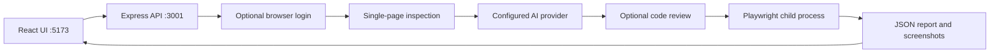

# Project review and product direction

Reviewed: 2026-10-10. Source baseline: local commit `70c6546`.
Perspective: QA engineering, application development, and usability.

## Assessment

Test Army is a useful prototype for assisted browser-test authoring. Its strongest
features are the short URL/description workflow, page inspection, login reuse,
editable generated code, reruns, and failure screenshots. The next milestone is a
trustworthy local QA tool: every result must describe what actually ran, and one
run must never reuse another run's evidence or credentials.

The user's existing workflow is valid: Vite on port 5173 and Express on port 3001.
`npm run dev:all` already starts both. This is development startup; the separate
`npm run build` command currently fails. Earlier analysis of the default E2E
script should not be confused with the UI's execution path: the server explicitly
uses `playwright.external.config.ts` and selects a generated file.

## Current architecture

The server combines login, crawling, prompting, provider access, execution, report
parsing, and HTTP handling in one file. The frontend combines inputs, streaming,
run state, the editor, and reports in one component. Split these along the task
boundaries below as behavior is covered; a full rewrite is unnecessary.

## Baseline checks actually attempted

| Check | Outcome | Evidence and meaning |
| --- | --- | --- |
| `npm.cmd run build` | FAIL | TS6133: unused `screen` in `src/App.test.tsx:1`; TS2769: Vite `defineConfig` does not accept the `test` property in `vite.config.ts:6`. |
| `npm.cmd run lint` | FAIL | One reported unused-variable error for `screen`. |
| `npm.cmd run test:unit` | BLOCKED | Vitest failed loading configuration with `spawn EPERM` in Vite's dependency handling. No passing unit result established. |
| `npm.cmd run test:e2e -- tests/home.spec.ts --workers=1 --reporter=line --output=test-results/project-review` | BLOCKED | Playwright returned `Error: spawn EPERM`; no browser journey completed. |

Some initial concurrent shell launches also failed with Windows access-denied
errors. Sequential attempts produced the results above. These environment
failures are recorded separately from product defects. No live provider call or
private target test was made. UI observations below are from code, not a visual
browser review. See `QA_STRATEGY.md` for the required runtime review.

## Findings and priorities

Severity is based on code review unless runtime evidence is stated above.

| ID | Priority | Finding and effect | Source | Task |
| --- | --- | --- | --- | --- |
| F01 | P0 | Runner errors without the text ` failed` can produce an "All tests passed" banner. The backend sends `done` on runner failure; the UI infers success from console text. | `server.mjs:405`, `src/App.tsx:63`, `src/App.tsx:366` | TA-002 |
| F02 | P0 | Executable generated/edited code runs with the server's environment, including provider credentials. The API has no authentication, uses unrestricted CORS, and does not explicitly bind loopback. Code checks are not isolation. | `server.mjs:15`, `server.mjs:292`, `server.mjs:415`, `server.mjs:477`, `server.mjs:501` | TA-004 |
| F03 | P1 | Shared auth, report, screenshot directory, and URL-derived filenames allow overlapping requests to mix evidence or overwrite code. A failed run can read an old report. | `server.mjs:43`, `server.mjs:405` | TA-003, TA-005 |
| F04 | P1 | Login announces success after a fixed wait without verifying an authenticated page. Invalid credentials can be saved as a supposedly valid session. | `server.mjs:46` | TA-005 |
| F05 | P1 | Build and lint failures are confirmed. Existing browser tests still assert Vite/React logos; the unit test asserts only that the document body exists. | `vite.config.ts`, `src/App.test.tsx`, `tests/home.spec.ts` | TA-001 |
| F06 | P1 | Stream consumption does not check HTTP status/content type or require a terminal event. JSON errors or a prematurely closed connection can leave the UI working indefinitely. | `src/App.tsx:95` | TA-002 |
| F07 | P1 | Startup always waits for a provider catalog request, even in Claude mode. There is no explicit fetch timeout; an empty catalog leaves no candidate and can result in `throw undefined`. | `server.mjs:22`, `server.mjs:240`, `server.mjs:500` | TA-006 |
| F08 | P1 | Prompting mandates fixed sleeps and asks for "real-looking" login credentials. Balanced braces and an import prefix do not establish valid, safe, or meaningful tests. | `server.mjs:219`, `server.mjs:229`, `server.mjs:292` | TA-010 |
| F09 | P1 | A two-minute process limit applies to suites requesting 15-25 tests, each with a 30-second timeout. No cancellation endpoint or per-run resource ownership exists; crawler failures can leak browsers without `finally`. | `server.mjs:79`, `server.mjs:426`, `playwright.external.config.ts` | TA-003 |
| F10 | P2 | Inspection samples a single page with small hard limits. It does not establish product requirements, all roles, navigation flows, or expected business outcomes. | `server.mjs:79`, `server.mjs:185` | TA-009, TA-010 |
| F11 | P2 | No durable projects, environment profiles, suite versions, history, or requirement-to-test links. Frontend API location is hard-coded. | `src/App.tsx:15`, component state | TA-008 |
| F12 | P2 | No CI workflow found. Default test discovery includes generated private-target specs. Traces are off externally; local traces require a retry but retries are zero. | `package.json`, both Playwright configs | TA-001, TA-007, TA-011 |
| F13 | P2 | Skipped/interrupted results are displayed as failed rows. Suite context and attempt history are lost in flattening. | `server.mjs:353`, `src/App.tsx:471` | TA-002, TA-011 |
| F14 | P2 | Template CSS remains in the global stylesheet, labels are not associated with several inputs, and guidance uses low-contrast colors. Runtime keyboard/responsive review is still needed. | `src/index.css`, `src/App.css`, `src/App.tsx` | TA-008, TA-013 |

P0 means it must be addressed before trusting results or widening use. P1 means
it prevents dependable daily operation. P2 expands capability or usability.

## How current QA tooling informs the direction

These are implications drawn from current official documentation, not claims
about market share or universal industry adoption.

- **Plan, generate, execute, diagnose.** Playwright documents planner, generator,
  and healer agents, including live selector/assertion verification during
  generation. Test Army should first expose reviewable scenarios and expected
  outcomes, then produce executable tests. Proposed repairs must retain original
  business assertions; a skipped scenario cannot count as successful coverage.
  [Playwright Test Agents](https://playwright.dev/docs/test-agents)
- **Stable behavior checks and isolation.** Use user-facing locators, automatic
  waiting, and isolated tests. Replace unconditional sleeps with observable
  readiness and use controlled test data.
  [Playwright best practices](https://playwright.dev/docs/best-practices)
- **Layered coverage.** Add API checks for setup and fast assertions, browser
  journeys for critical workflows, and accessibility/visual checks where they
  answer a specific risk. Automated accessibility checks need manual review too.
  [API testing](https://playwright.dev/docs/api-testing),
  [accessibility testing](https://playwright.dev/docs/accessibility-testing),
  [visual comparisons](https://playwright.dev/docs/test-snapshots)
- **Evidence for diagnosis.** Capture traces and relevant network/console events
  so a failure can be reproduced and classified.
  [Trace Viewer](https://playwright.dev/docs/trace-viewer)
- **AI input and execution boundaries.** Page content can contain indirect prompt
  injection. Keep scraped content separate from instructions, minimize exported
  data, validate output, and enforce execution permissions outside the prompt.
  [OWASP prompt injection guidance](https://cheatsheetseries.owasp.org/cheatsheets/LLM_Prompt_Injection_Prevention_Cheat_Sheet.html)

## Product experience to aim for

1. Create a product once: URL, environment, permitted hosts, roles, and test data.
2. Check connection and login; offer a manual recorded login for complex SSO.
3. Explore or record a workflow; collect requirements and expected results.
4. Review a short, risk-ranked scenario list with unresolved assumptions visible.
5. Run a small smoke suite quickly; reuse saved tests without regenerating them.
6. Open a failure and see expected versus actual behavior, reproduction steps,
   screenshots, trace, target build, and classification.
7. Save a regression suite and later connect it to builds or schedules.

Proposed modes: Quick smoke, Feature checks, Full regression. Reuse approved tests,
cache inspection per product/build/role, run API setup where possible, and add
bounded concurrency after run isolation. Measure speed before setting promises.

Initial supported scope should be browser-based products: conventional pages,
SPAs, forms, tables, search, and authenticated workflows. Add verified adapters
for custom components, iframes, uploads, and downloads. Publish a capability
matrix rather than promising every product works automatically. Native mobile,
desktop apps, CAPTCHA bypass, autonomous production writes, and full penetration
testing are outside the first milestone. A few injection input cases do not prove
that a product is secure.

## Proposed implementation boundaries

Keep the existing stack. Introduce a typed run/result contract; separate server
routes, provider adapters, browser exploration, session storage, runner lifecycle,
and report parsing. Separate frontend forms, streaming state, editor, and results.
Use a per-run directory from TA-003; add a local persistent project/history store
in TA-008. Choose its storage implementation in that task after defining the data
model: Product -> Environment/Role -> SuiteVersion -> Run -> Result/Artifact.

No queue service or distributed system is needed for the first local milestone.
Start with one active run and a clear busy response; add bounded queues only when
isolated jobs and cleanup are verified. Raw code execution needs an actual
restricted worker/container or equivalent OS boundary before shared/hosted use.
Review and static checks alone are insufficient. Explicitly permitted intranet
targets must remain usable; blanket rejection of all private IPs would defeat
the user's workflow. Enforce configured hosts, redirects, and worker egress.

## Measures of success

Establish baselines on local fixtures before choosing numerical speed targets:
time to first reviewed executable suite, smoke-run median/p95, valid generated
test rate, known-defect detection, false-positive rate, flaky rerun rate, and
provider latency/cost. Record sample sizes and provider/prompt versions. Count
requirements and meaningful checks; number of generated tests is not coverage.
Zero false-success outcomes on the runner error matrix is a release requirement.

See `TASKS.md` for sequencing and `QA_STRATEGY.md` for completion evidence.

